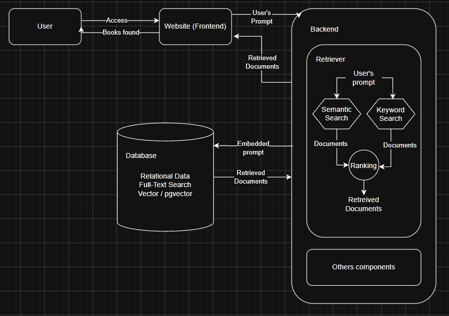

<div align="center">

# 📖 Blooking

**An event-driven book-discovery platform with multilingual hybrid search (semantic + keyword) and personalized recommendations.**

Search by *meaning*, not just keywords — in English **or** Portuguese — over a catalog of ~3,000 books, with recommendations that learn from what you view and favorite.

<!-- Badges: CI workflow + a live-demo link will be added once the pipeline and demo exist. -->


<br/>


</div>

---

## How it works

- **🔍 Hybrid search with Reciprocal Rank Fusion (RRF).** Every query runs two retrievers in parallel — **semantic** (vector similarity over `pgvector`) and **keyword** (PostgreSQL full-text search) — and the two ranked lists are fused with RRF (`k = 60`), combining conceptual relevance with exact-term matching without hand-tuned score normalization.
- **🌐 Multilingual semantic search.** Queries in **English or Portuguese** are embedded with the multilingual `bge-m3` model (1024-dim vectors via Ollama / Spring AI) and matched against the same catalog — no translation step. If the embedding backend is unavailable, search falls back to keyword-only.
- **⚡ Event-driven recommendations.** User interactions (`viewed` / `searched` / `favorited` / `unfavorited`) are published to **RabbitMQ**; an asynchronous worker consumes them, maintains an append-only audit log, and recomputes each user's **preference embedding** (a weighted centroid of the books they engaged with) to serve personalized results. Users with no history yet get a popularity-based cold-start fallback.
- **🔐 Stateless, hardened auth.** JWT access tokens + revocable refresh tokens delivered as an `HttpOnly` cookie, CSRF double-submit protection, BCrypt password hashing, and per-IP rate limiting on the auth endpoints.
- **🧱 Reliable messaging.** Durable queues, a dead-letter queue for poison messages, and idempotent consumers (each event carries a unique `eventId`) make delivery at-least-once and safe to retry.

## Architecture

A Spring Boot **modular monolith** backend, a React frontend, and PostgreSQL (`pgvector`) as the single store for relational data, full-text search, and vector embeddings — with RabbitMQ carrying interaction events to the recommendation worker.

<div align="center">

</div>

> Full write-up (data flow, retrieval, messaging topology, security) in **[`docs/architecture.md`](./docs/architecture.md)**.

## Tech Stack

| Layer | Technologies |
| :--- | :--- |
| **Frontend** | React 18, TypeScript, Vite, Tailwind CSS v4, TanStack Query, React Router, Axios |
| **Backend** | Java 21, Spring Boot 3.5 (Spring Data JPA, Spring AI, Spring AMQP), Flyway |
| **Data** | PostgreSQL + `pgvector` (relational + full-text search + vector embeddings) |
| **Messaging** | RabbitMQ (topic exchange, durable queue, dead-letter queue) |
| **Embeddings** | `bge-m3` (multilingual, 1024-dim) via Ollama |
| **Infra** | Docker & Docker Compose |

## Project Structure

This project is built as a **monorepo** containing both the frontend and backend services:

| Directory | Description | Tech Stack |
| :--- | :--- | :--- |
| **[`apps/backend`](./apps/backend)** | Core REST API for search and recommendation processing | Java 21, Spring Boot, PostgreSQL (pgvector), RabbitMQ |
| **[`apps/frontend`](./apps/frontend)** | Web user interface for book discovery | React, TypeScript |
| **[`docs`](./docs)** | Project documentation (Architecture, API specs, User Stories) | Markdown |

> *Check the `README.md` inside each application folder under `apps/` for detailed setup and usage instructions.*

## Quick Start

### Prerequisites
* [Docker Desktop](https://www.docker.com/) installed and running (for Postgres + pgvector, RabbitMQ and Ollama)
* [Java 21](https://adoptium.net/) & [Node.js 20+](https://nodejs.org/)

### Running the App

1. **Clone the repository and start the infrastructure** (Postgres + pgvector, RabbitMQ, Ollama):
   ```bash
   git clone https://github.com/PedroRosa-Gif/blooking.git
   cd blooking
   cp .env.example .env        # adjust values if needed
   docker compose up -d
   ```

2. **Run the backend** (from `apps/backend`):
   ```bash
   cd apps/backend
   ./mvnw spring-boot:run       # starts on http://localhost:8080
   ```
   > ⚠️ The first startup seeds ~3,000 books and generates an embedding for each
   > via Ollama (`bge-m3`), which can take several minutes. It runs once and is
   > idempotent on restart. See [`apps/backend/README.md`](./apps/backend/README.md).

3. **Run the frontend** (from `apps/frontend`, in a second terminal):
   ```bash
   cd apps/frontend
   cp .env.example .env         # defaults to the backend on :8080
   npm install
   npm run dev                  # http://localhost:5173
   ```

Open **http://localhost:5173** to use the app. For details (environment
variables, endpoints, auth, tests) see the per-app READMEs linked in the table
above.
