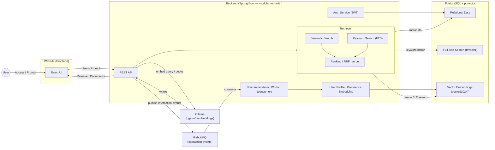

# Project Overview

A book search and recommendation platform that leverages hybrid search (semantic + keyword search) over a knowledge base. The system delivers relevant book results via vector embeddings and provides personalized recommendations based on user interaction events through an event-driven architecture.

# Architecture Diagram




# Tech Stack

* **Frontend:** React, TypeScript, Axios / React Query.
* **Backend:** Java 21, Spring Boot (Spring Data JPA, Spring AI, Spring AMQP / REST APIs).
* **Database:** PostgreSQL with `pgvector` extension (for Relational Data, Full-Text Search, and Vector Embeddings).
* **Event Broker:** **RabbitMQ** — self-hostable and free, running as a container in the local `docker-compose`. Provides a real message broker with durable queues, retries, and dead-letter queues (DLQ) for asynchronous interaction/recommendation events.
* **Embedding Model:** **`bge-m3` via Ollama** — multilingual (100+ languages, firm support for **English and Portuguese**), 8K context, outputs **1024-dimensional** vectors.
* **Database Migrations:** **Flyway** (versioned SQL migrations).
* **Containerization:** Docker & Docker Compose.

# Core Architectural Concepts & Data Flow

### Hybrid Search Engine (Retriever)
When a user submits a prompt via the Frontend:
1. **Embedding Generation:** The **Backend** calls Ollama (`bge-m3`) to convert the input query into a 1024-dimensional vector embedding. The database only stores and compares vectors — embedding generation is a backend responsibility.
2. **Parallel Retrieval:**
   * **Semantic Search:** Queries vector embeddings stored in PostgreSQL using `pgvector` (cosine similarity / L2 distance).
   * **Keyword Search:** Queries standard text using PostgreSQL Full-Text Search (`tsvector`).
3. **Ranking & Merging:** The Retriever combines and re-ranks results from both strategies using **Reciprocal Rank Fusion (RRF)** before sending the `Retrieved Documents` back to the Frontend.
   * RRF is chosen as the baseline because it fuses two ranked lists without needing to normalize scores of different natures (cosine distance vs. text-match relevance). It uses the conventional constant `k = 60`.
   * Each strategy contributes up to 50 candidates; the fused list is truncated to the requested page size.
   * **Keyword field weighting** (FTS) is configured on the generated `search_vector` column with the priority **title (A) > author (B) > description (C) > genres (D)**.
   * If the embedding backend (Ollama) is unavailable at query time, search **degrades gracefully to keyword-only** results instead of failing.

   Exposed as `GET /api/search?q=...&limit=...`.

### Multilingual Embedding Strategy
To support Portuguese and English queries over an English dataset without manual translation, the backend relies on the multilingual embedding model **`bge-m3`** (via Ollama / Spring AI). Other languages are not required.

When indexing, a structured context string is created per book and embedded:
```text
Title: {title} | Author: {author} | Genres: {genres} | Description: {description}
```

### Embedding Runtime (Ollama) — local execution strategy
`bge-m3` is a multilingual model and is heavier than English-only alternatives (quantized Ollama build ~1.2–1.7 GB in memory; the full build is ~3 GB). English-only lightweight models (e.g. `nomic-embed-text`, `all-MiniLM-L6-v2`) were **rejected** because they do not meet the firm Portuguese requirement. The workload is light in practice: the ~3,000 books are embedded once at ingestion, and at query time only short user prompts are embedded.

To keep the project easy to run on modest machines:
* By default, Ollama runs as a **container service** in `docker-compose` (single `docker-compose up` brings up everything).
* The backend reaches Ollama via an `OLLAMA_BASE_URL` environment variable, so on low-memory machines it can instead point to a **native Ollama install on the host** (e.g. Ollama for Windows/macOS) without any code change. The native packager does not make the model smaller — the model size is identical — but running on the host can use better CPU/GPU acceleration.

### Event-Driven Recommendations
User actions publish events to **RabbitMQ**. A background consumer (**Recommendation Worker**) processes these preference events asynchronously to update the user's profile embedding and generate personalized recommendations without blocking main search requests.

**Interaction events (initial contract):**

| Event | Trigger | Requires login? |
| :--- | :--- | :--- |
| `book.viewed` | User opens a book detail page (US04) | No |
| `book.searched` | User submits a search query | No |
| `book.favorited` | Logged-in user favorites a book | Yes |
| `book.unfavorited` | Logged-in user removes a favorite | Yes |

**Messaging topology (implemented):**

* **Topic exchange** `blooking.events`; producers publish with the event's routing key (`book.viewed`, etc.).
* A durable queue **`book.events`** is bound with the pattern `book.*` and consumed by the interaction consumer.
* Messages are **persistent JSON** (survive a broker restart). Delivery is **at-least-once**, so the consumer is **idempotent**: each event carries a UUID `eventId` and is recorded at most once (`interactions.event_id` is `UNIQUE`).
* A **Dead Letter Queue** (`book.events.dlq`, via a dead-letter exchange) captures messages that keep failing, instead of losing them or retrying forever.
* **Publishing is best-effort** this phase: if the broker is down, the user action still succeeds and the event is dropped (logged). A **transactional outbox** is noted as a future hardening step for guaranteed delivery.

The consumer persists every event to the append-only **`interactions`** table (audit log + recommendation source) and acts as the **Recommendation Worker**: on each `book.favorited` / `book.unfavorited` event it recomputes the user's **profile embedding** — the centroid (mean vector) of the embeddings of the books the user currently favorites — and stores it in the `user_profiles` table (migration `V8`).

`GET /api/recommendations` (authenticated, US05) then serves personalized results: the books whose embeddings are nearest (cosine distance) to the user's profile embedding via `pgvector`, excluding books already favorited. Users without a profile embedding yet (no favorites) get a **popularity-based cold-start fallback** (by `num_ratings`, then `rating`), so the recommendations section is never empty. The centroid is recomputed from the live `favorites` table on every event, so it is self-correcting and idempotent under at-least-once redelivery.

## Data Source & Pipeline

* **Dataset:** [Best Books Ever Dataset (Kaggle)](https://www.kaggle.com/datasets/pooriamst/best-books-ever-dataset/data)
* **Dataset Scope:** **Sampled to ~3,000 top records** (out of 52,000) for fast local development, low memory footprint, and quick vector embedding generation.
* **Key Fields Utilized:**
  * `title`, `author`, `genres` — Used for Full-Text Search and categorical filtering.
  * `description` — Primary textual source for generating dense vector embeddings.
  * `coverImg` — Used by the frontend interface for book cards and details.
  * `rating`, `numRatings` — Used as factors in the candidate re-ranking step.

# Infrastructure & Deployment

* **Environments:** Development (Docker Compose, including PostgreSQL+pgvector, RabbitMQ, and Ollama) / Production (AWS ECS / Kubernetes — future).
* **CI/CD:** GitHub Actions pipeline running unit, integration tests, and container image builds.

# Security & Authentication

* **Authentication:** Stateless, token-based.
  * **Access token:** short-lived JWT (HS256, ~15 min), sent as `Authorization: Bearer`.
  * **Refresh token:** long-lived (~7 days), opaque random string, **stored hashed**
    (SHA-256) in the `refresh_tokens` table so it is server-side **revocable**.
  * **Rotation:** each `/api/auth/refresh` revokes the presented refresh token and
    issues a new one. **Logout** revokes the refresh token.
  * Login is by **username** (email + verification/recovery is a future addition).
  * Passwords hashed with **BCrypt**.
* **Public vs. protected:** book discovery (`/api/books/**`, `/api/search`) and the
  auth entry points are public; everything else requires a valid access token.
* **API Security:** CORS restricted to the configured frontend origin; CSRF disabled
  (token-based, not cookie-based — to be revisited when refresh tokens move to an
  HttpOnly cookie); rate limiting on auth/search endpoints is a planned hardening step.
* **Gated actions:** favoriting/unfavoriting books requires an authenticated user.

> **Token transport evolution:** currently both tokens travel in the JSON body /
> `Authorization` header (clean, frontend-agnostic). Once the React frontend
> exists, the refresh token will move to an `HttpOnly`/`Secure`/`SameSite` cookie
> to protect it from XSS theft, with CSRF protection added accordingly.
